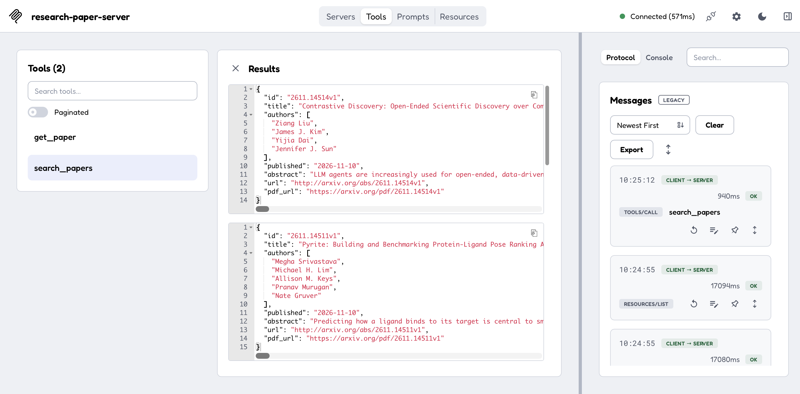

# Research Paper MCP Server



A lightweight Python MCP (Model Context Protocol) server that enables AI assistants to search and retrieve research papers from [arXiv](https://arxiv.org/).

Built using the official Python MCP SDK and the arXiv API.


## Features

The server exposes two MCP tools:

| Tool | Description |
|---|---|
| `search_papers` | Search arXiv by query and retrieve paper metadata |
| `get_paper` | Retrieve details of a specific paper using its arXiv ID |

Returned metadata includes paper titles, authors, publication dates, abstracts, and URLs.

## Architecture

```text
AI Assistant / MCP Inspector
           |
           | MCP (stdio)
           v
    Python MCP Server
           |
           | arXiv API
           v
        arXiv
           |
           v
   Structured Paper Metadata
```

## Prerequisites

- Python 3.11+
- [uv](https://docs.astral.sh/uv/) for Python dependency management
- Node.js and `npx` for MCP Inspector
- Internet access for retrieving papers

No API key is required.

## Installation

### 1. Set up the project

Create a directory and initialize the project:

```bash
uv init research-paper-mcp
cd research-paper-mcp
```

If you have cloned this repository instead, navigate to the project directory and run `uv sync`.

### 2. Install dependencies

```bash
uv add "mcp[cli]" arxiv
```

This installs the MCP Python SDK, development CLI, and arXiv Python client.

### 3. Project structure

```text
research-paper-mcp/
├── server.py
├── pyproject.toml
├── uv.lock
└── README.md
```

The MCP server implementation is contained in `server.py`.

## Running the Server

### 1. Launch MCP Inspector

From the project directory, run:

```bash
uv run mcp dev server.py
```

This starts the MCP Inspector development environment.

Open the local URL displayed in your terminal.

### 2. Connect to the MCP server

In the MCP Inspector browser interface:

1. Locate the **Connection** panel.
2. Select **STDIO** as the transport type.
3. If the connection settings are already populated, leave them unchanged.
4. Otherwise, configure the command to launch the server from the project directory.
5. Click **Connect**.

Keep the original terminal running while testing.

### 3. Discover the tools

After connecting:

1. Open the **Tools** tab.
2. Click **List Tools**.
3. Verify that the following tools are available:
   - `search_papers`
   - `get_paper`

## Testing the Tools

### Example 1: Search for papers

Select `search_papers` and enter:

```json
{
  "query": "large language models",
  "max_results": 3
}
```

Click **Run Tool**.

Expected response: A list of up to three matching research papers, including their titles, authors, abstracts, publication dates and URLs.

### Example 2: Retrieve a specific paper

Select `get_paper` and enter:

```json
{
  "arxiv_id": "1706.03762"
}
```

Click **Run Tool**.

This retrieves metadata for *Attention Is All You Need*, the Transformer architecture paper.

## How MCP Works

The Model Context Protocol provides a standardized interface through which AI applications can discover and invoke external tools.

In this project:

1. The MCP server registers Python functions as tools using the MCP SDK.
2. An MCP client connects to the server using the stdio transport.
3. The client discovers available tools and their input schemas.
4. The client invokes a tool with structured arguments.
5. The server queries arXiv and returns structured results.

The MCP Inspector acts as a development and testing client. An MCP-compatible AI assistant can use the same tools for natural-language research queries.

## Technology Stack

- **Python** — Server implementation
- **MCP Python SDK** — Tool registration and protocol communication
- **arxiv** — Python client for the arXiv API
- **uv** — Dependency management
- **MCP Inspector** — Interactive testing and debugging

## Limitations

- Searches rely on the arXiv API and require an internet connection.
- Paper retrieval returns metadata and abstracts, not full-text analysis.
- Search results are subject to arXiv API availability and rate limits.
- This repository provides the MCP server, not a standalone AI chatbot.

## Future Improvements

- Automated tool testing with pytest
- Paper comparison and citation extraction
- Full-text PDF retrieval
- Integration with an MCP-compatible AI assistant

## References

- [Model Context Protocol](https://modelcontextprotocol.io/)
- [Official Python MCP SDK](https://github.com/modelcontextprotocol/python-sdk)
- [arXiv API](https://info.arxiv.org/help/api/index.html)